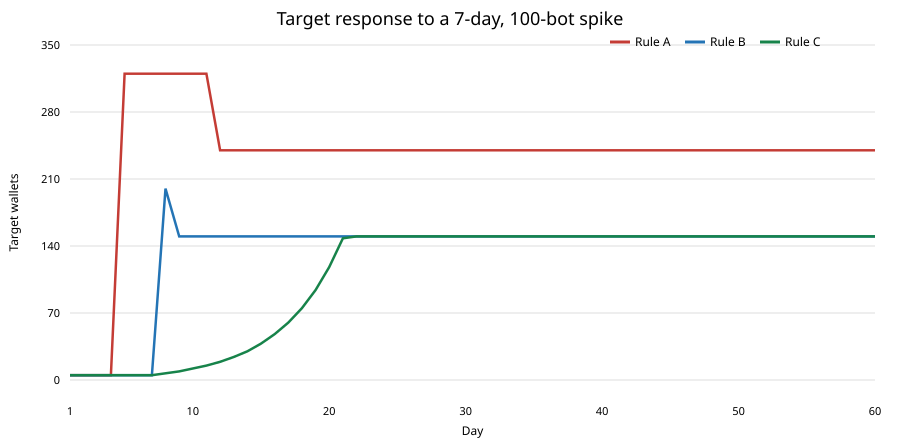

# Adaptive target policy comparison

This is a deterministic 60-day evidence exercise. It does not change the CROC contract and none of these target policies or weekly challenges are implemented.

## Rules compared

Each policy starts at target 5, with seven earlier days seeded to 5. After each settlement, it uses the previous seven completed days of total check-ins, including bot wallets:

- **A:** `max(5, ceil(0.8 × median(last 7 days)))`.
- **B:** `max(5, floor(0.5 × min(last 7 days))`.
- **C:** policy B, except a rising target is capped at `ceil(1.25 × yesterday's target)`. A falling target follows B immediately.

The daily token model starts with a 300 million CROC treasury and a 700 million CROC emission pool. It uses RULES.md integer floors for the pot, 90/10 split, per-checker mint, 5% missed-day burn, supply limit, and the milestone schedule already in the contract. A successful day is when total check-ins meet the target. Rewards go to an escrow balance; claims do not change supply.

Scenario inputs are explicit: steady crowds of 200, 500 and 1,000 wallets each check in at 60% participation; the bot spike and sustained-bot cases use a 500-wallet human crowd at 60% participation plus 100 bots (the spike ends after day 7); fading humans start at 60% and decline linearly to 20% participation by day 60. The variable scenarios use a 500-wallet human crowd because no other crowd size was specified for them.

“Days to recover” is the number of days from the first miss to the next successful day; 0 means no missed days. “Not within 60 days” means there is no later success in this modeled window. Treasury burn is shown in CROC, preserving all 18 decimal places.

## Results

The following values match the workflow output published at SHA `fb1ea339f417f91eab77b1ed6add12c6052d4aa1` (`adaptive_target_summary.md` and its CSV files on `ci-logs`).

| Scenario | Wallets | Rule | Missed days | Treasury burned (CROC) | Days to recover |
|---|---:|:---:|---:|---:|---:|
| steady_200 | 200 | A | 0 | 0.000000000000000000 | 0 |
| steady_200 | 200 | B | 0 | 0.000000000000000000 | 0 |
| steady_200 | 200 | C | 0 | 0.000000000000000000 | 0 |
| steady_500 | 500 | A | 0 | 0.000000000000000000 | 0 |
| steady_500 | 500 | B | 0 | 0.000000000000000000 | 0 |
| steady_500 | 500 | C | 0 | 0.000000000000000000 | 0 |
| steady_1000 | 1000 | A | 0 | 0.000000000000000000 | 0 |
| steady_1000 | 1000 | B | 0 | 0.000000000000000000 | 0 |
| steady_1000 | 1000 | C | 0 | 0.000000000000000000 | 0 |
| bot_spike_500 | 500 | A | 4 | 55534866.073297207298913483 | 4 |
| bot_spike_500 | 500 | B | 0 | 0.000000000000000000 | 0 |
| bot_spike_500 | 500 | C | 0 | 0.000000000000000000 | 0 |
| sustained_bots_500 | 500 | A | 0 | 0.000000000000000000 | 0 |
| sustained_bots_500 | 500 | B | 0 | 0.000000000000000000 | 0 |
| sustained_bots_500 | 500 | C | 0 | 0.000000000000000000 | 0 |
| humans_fading_500 | 500 | A | 0 | 0.000000000000000000 | 0 |
| humans_fading_500 | 500 | B | 0 | 0.000000000000000000 | 0 |
| humans_fading_500 | 500 | C | 0 | 0.000000000000000000 | 0 |

For the bot-spike scenario, the daily CSV shows rule A at target 320 on day 8 while humans return to 300 check-ins; it misses days 8–11 and succeeds on day 12 after the target falls to 240. Rule B has target 200 on day 8 and 150 by day 10, with no misses. Rule C raises its target gradually after the spike and also has no misses. This is a modeled tradeoff: A reacts more sharply to a short-lived spike, while B/C use the recent minimum and C limits increases.

## Weekly challenge pool example

For one illustrative week, assume 100 human wallets and all listed bot wallets qualify by checking in all seven days. Start with the 300,000,000 CROC treasury. The weekly pool is `floor(treasury / 100)` = 3,000,000 CROC, split evenly across all eligible wallets with integer division; undistributed dust stays in the pool.

| Eligible bot wallets | Total eligible wallets | Bot share of eligible wallets | Amount captured by bots (CROC) | Share of weekly pool captured |
|---:|---:|---:|---:|---:|
| 5 | 105 | 4.7619% | 142857.142857142857142855 | 4.7619% |
| 50 | 150 | 33.3333% | 1000000.000000000000000000 | 33.3333% |

This isolates one week and does not feed the hypothetical challenge payout back into the 60-day daily-burn scenarios. It illustrates that wallets that can check in every day could capture a substantial fraction of a participation-based weekly pool. The weekly challenge is evidence only and is not implemented.

## Reproduce the data

Run `python3 scripts/simulate_adaptive_target.py`. The script uses only Python's standard library and writes daily and summary CSVs plus the SVG chart into `docs/simulation/`. The tracked chart is `adaptive_target.svg`.
